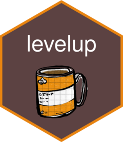

# {levelup} 

<!-- badges: start -->
[](https://www.tidyverse.org/lifecycle/#experimental)
[](https://github.com/StatsRhian/levelup/actions/workflows/R-CMD-check.yaml)
[](https://StatsRhian.r-universe.dev/levelup)
<!-- badges: end -->

The goal of levelup is to read in specific yaml files and convert them to tibbles for analysis of CPD data.

## Installation
Run the following R command to install {lovedial}:

```{r}
# install.packages("pak") # if not already installed
pak::pak("statsrhian/levelup")
```
